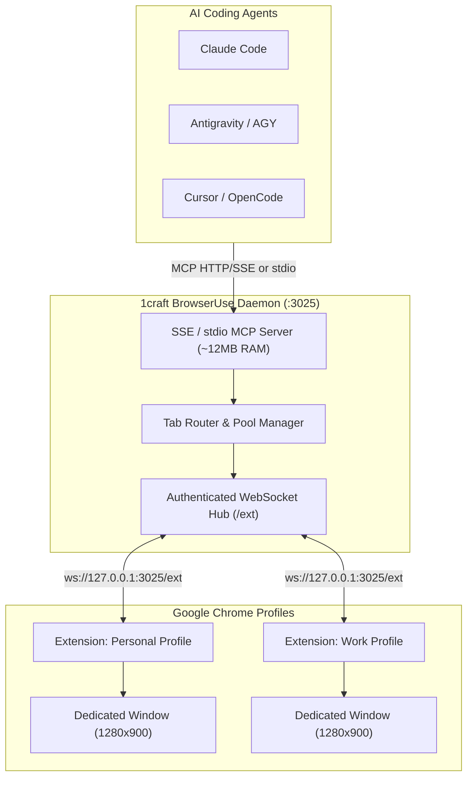

# 1craft BrowserUse

> **Control your browser with your AI**

[](https://github.com/chavisnguyen/1craft-browseruse/releases)
[](https://github.com/chavisnguyen/homebrew-browseruse)
[](https://github.com/chavisnguyen/1craft-browseruse/actions/workflows/ci.yml)
[](https://golang.org)
[](https://modelcontextprotocol.io)
[](LICENSE)
[](README.md)

**1craft BrowserUse** is an ultra-lightweight (~12MB RAM), blazingly fast [Model Context Protocol (MCP)](https://modelcontextprotocol.io) server written in **Golang**. It connects AI agents (**Claude Code**, **Antigravity / AGY**, **Cursor**, **OpenCode**, **Kiro**, **Claude Desktop**) directly to your real browser sessions, cookies, logins, and multiple Chrome profiles—**without requiring macOS Full Disk Access** and **without stealing your mouse focus**.

---

## ⚡ Highlights

* **Ultra-Lightweight (~12MB RAM):** Written in pure Go with zero heavy Python or Node runtimes. The background daemon serves multiple AI agents while consuming less than 15MB of memory.
* **Multi-Agent Concurrency & Tab Pooling:** Run one shared daemon (`make daemon`). When multiple AI agents work at the same time, the server automatically assigns and isolates independent tabs (`tab-1`, `tab-2`...), preventing collisions or race conditions.
* **No macOS Full Disk Access Needed:** Unlike legacy Chrome CDP setups blocked by macOS TCC permissions when reading `DevToolsActivePort`, the 1craft MV3 Chrome Extension bridge connects over authenticated local WebSockets.
* **Multi-Profile Isolation (`work`, `personal`...):** Connect multiple Chrome profiles simultaneously. Agents can route tasks to designated profiles (e.g., `browser_new_tab(url, profile="work")`). Profile labels can be customized or auto-derived from your logged-in Google Accounts.
* **Dedicated Background Window:** Agent tabs run inside an isolated, standardized 1280×900 dedicated window. The AI browses, clicks, and types without interfering with your active personal windows or hijacking your cursor.
* **Zero-Dependency Installation:** Install in seconds via Homebrew (`brew install browseruse`) or compile from source with `make setup`.
* **Zero API Key Overhead:** Directly leverages your AI agent's native vision and reasoning capabilities via DOM snapshots and element selector maps.

---

## 🏗️ Architecture



### Backend Resolution Hierarchy

When an agent requests a new tab, the router selects the best available backend in the following order:

| Priority | Backend Engine | Activation Condition | macOS Permissions | Profiles & Cookies | User Experience |
| :---: | :--- | :--- | :---: | :--- | :--- |
| **1 (Recommended)** | **Chrome Extension Bridge** | Extension online in Chrome | 🟢 **None (No FDA)** | ✅ All logged-in profiles & cookies (`work`, `personal`) | Standardized 1280×900 dedicated window; zero mouse theft |
| **2** | **Existing Chrome (CDP)** | `chrome://inspect` enabled; no extension | 🟡 **Full Disk Access** required for terminal | ✅ Primary profile | Direct tabs in your active Chrome window |
| **3** | **Dedicated Chrome (Port 9222)** | Started via `make chrome` | 🟢 None | ✅ (Main) / ❌ (Isolated) | Separate Chrome instance |
| **4** | **Fallback Headless Chrome** | None of the above available | 🟢 None | ❌ Ephemeral session (cookies lost on exit) | Headless background process |

---

## 🚀 Quickstart

### Method 1: Homebrew (Recommended — No Go Runtime Needed)

```bash
brew tap chavisnguyen/browseruse
brew install browseruse

# Start the shared background MCP daemon (managed via macOS launchd)
brew services start browseruse
```

Get your extension authentication token:
```bash
1craft-browseruse -token
```

Load the extension:
1. Open Chrome and navigate to `chrome://extensions`.
2. Turn ON **Developer mode** (top-right switch).
3. Click **Load unpacked** and select:
   ```
   $(brew --prefix)/share/browseruse/extension
   ```
4. In extension Options, paste your token and click Save.
5. Add `http://localhost:3025/mcp` to your MCP client (Claude Code, AGY, Cursor, OpenCode).

---

### Method 2: From Source (Developers)

#### Prerequisites
* macOS, Linux, or Windows (WSL)
* [Go 1.22+](https://golang.org) installed
* Google Chrome (or Chromium-based browser)

#### 1-Click Setup

Clone the repository and run:

```bash
git clone https://github.com/chavisnguyen/1craft-browseruse.git
cd 1craft-browseruse
make setup
```

This single command will:
1. Compile the high-performance Go binary (`bin/browseruse`).
2. Generate a secure, unique authentication token.
3. Automatically embed the credentials into `extension/default_config.json`.
4. Register the MCP server (`1craft-browseruse`) across **AGY**, **Claude Code**, **Claude Desktop**, **Cursor**, and **OpenCode**.
5. Start the background SSE daemon on port `3025`.
6. Copy the absolute path of the `extension/` directory straight to your clipboard (macOS).

Then open `chrome://extensions`, enable **Developer mode**, click **Load unpacked**, and select the `extension` folder (`Cmd+Shift+G` -> `Cmd+V` -> `Enter`).

---

## 🛠️ Makefile Commands

| Command | Description |
| :--- | :--- |
| `make setup` | **1-Click zero-config setup**: compiles binary, sets up tokens, installs MCP, and launches daemon |
| `make daemon` | Start the MCP SSE server in the background at `http://localhost:3025/mcp` |
| `make stop` | Stop the background SSE daemon |
| `make restart` | Restart the background SSE daemon |
| `make status` | Check status of the daemon and connected browser instances |
| `make token` | Print the current cryptographic authentication token |
| `make install` | Configure MCP in SSE mode (`http://localhost:3025/mcp`) for all installed agents |
| `make install-stdio` | Configure MCP in stdio mode (direct binary execution) |
| `make chrome` | Launch Chrome with remote debugging on port 9222 (optional legacy CDP fallback) |
| `make test` | Run the full automated integration and multi-tab test suite |
| `make clean` | Remove compiled binaries, temporary logs, and PID files |

---

## 🌐 Available MCP Tools

AI agents connected to 1craft BrowserUse have access to the following 13 tools:

| Tool | Parameters | Description |
| :--- | :--- | :--- |
| `list_profiles` | *none* | Lists all currently connected Chrome Extension profiles (label, signed-in email, active tab count). |
| `browser_new_tab` | `url` *(string)*<br>`profile` *(optional string)* | Opens a new independent browser tab and returns its `tab_id` (e.g. `tab-1`) and page summary. Supports targeting profiles (e.g. `work`). |
| `browser_list_tabs` | *none* | Lists all active tabs, their assigned profile tags, URLs, page titles, and the current active tab marker. |
| `browser_close_tab` | `tab_id` *(string)* | Closes a specific tab when the agent finishes its task. |
| `browser_navigate` | `url` *(string)*<br>`tab_id` *(optional string)* | Navigates the specified (or active) tab to a new URL. |
| `browser_snapshot` | `tab_id` *(optional string)* | Extracts an interactive accessibility DOM tree with clickable elements, inputs, buttons, and selector IDs. |
| `browser_click` | `selector` *(string)*<br>`tab_id` *(optional string)* | Clicks an element identified by CSS selector, text match, or snapshot element index. |
| `browser_type` | `selector` *(string)*<br>`text` *(string)*<br>`press_enter` *(optional bool)*<br>`tab_id` *(optional string)* | Types text into an input field or textarea, optionally submitting with `Enter`. |
| `browser_press_key` | `key` *(string)*<br>`tab_id` *(optional string)* | Dispatches a keyboard event (e.g. `Enter`, `Escape`, `ArrowDown`, `Tab`). |
| `browser_screenshot` | `filename` *(optional string)*<br>`tab_id` *(optional string)* | Captures a PNG screenshot of the tab view and returns the local file path. |
| `browser_evaluate` | `script` *(string)*<br>`tab_id` *(optional string)* | Evaluates arbitrary JavaScript code in the context of the page and returns the result. |
| `get_browser_status`| *none* | Returns comprehensive system diagnostics, connected extension profiles, and open tab allocations. |
| `browser_close` | *none* | Closes all managed tabs and releases associated browser resources. |

---

## 👥 Multi-Profile Usage & Agent Prompting

You can run the extension across multiple Google Chrome profiles simultaneously (e.g. your personal profile, company work profile, or separate staging accounts).

### Automatic Profile Labeling

When the extension is loaded into a profile signed in with a Google Account, 1craft BrowserUse automatically derives a human-friendly profile label:
* `user@gmail.com` ➔ `gmail_user`
* `alice@company.com` ➔ `company_alice`

You can also customize the label at any time in **Extension Options**.

### Prompting Examples

* **Single Profile Connected:**
  Agents automatically route tabs to the single online profile without requiring explicit parameters.
* **Multiple Profiles Connected:**
  Agents can specify the target profile when creating tabs:
  ```text
  "Open my company dashboard in the work profile and download the weekly sales report."
  ```
  The agent will invoke:
  ```json
  browser_new_tab({"url": "https://dashboard.internal", "profile": "work"})
  ```
* If multiple profiles are connected and no profile is specified, the server responds with a descriptive message listing all available profile labels so the agent can self-correct.

---

## ⚙️ Configuration & Environment Variables

Configuration can be specified via environment variables or a local `.env` file in the project root:

| Variable | Default | Description |
| :--- | :--- | :--- |
| `PORT` | `3025` | Port for the HTTP/SSE MCP daemon and WebSocket hub. |
| `CHROME_CDP_URL` | `http://127.0.0.1:9222` | Fallback CDP endpoint (used when Extension Bridge is not connected). |
| `BROWSER_HEADLESS` | `true` | Headless mode for fallback standalone Chrome. Set to `false` to show GUI. |

---

## 🧯 Troubleshooting

### Extension status shows "Disconnected" or red exclamation badge
* Ensure the daemon is running (`make daemon`).
* Verify the auth token: run `make token`, open **Extension Options**, paste the token, and click **Save & Connect**.

### Chrome displays yellow banner: *"1craft BrowserUse started debugging this browser"*
* This is a standard Google Chrome security alert when an extension connects to a tab via `chrome.debugger`. It is completely normal, expected, and safe.

### Agent reports *"multiple extension profiles online"*
* Two or more Chrome profiles are connected. Instruct your agent to specify which profile to use (e.g., `profile="work"` or `profile="gmail_user"`), or check online profiles with `list_profiles()`.

### Agent reports *"label_in_use"*
* Two Chrome windows/profiles are configured with the identical profile label. Open **Extension Options** in one of them and give it a unique name.

### macOS `operation not permitted` when reading `DevToolsActivePort`
* This only occurs when using the legacy CDP fallback without the extension. The recommended fix is to load the **1craft Chrome Extension**, which requires **no Full Disk Access**. If you must use legacy CDP, grant Full Disk Access to your terminal app in *System Settings → Privacy & Security → Full Disk Access*.

---

## 🔒 Security & Privacy

* **Strict Loopback Binding:** The daemon and WebSocket hub bind exclusively to `127.0.0.1` and `[::1]`. No external network exposure.
* **Cryptographic Authentication:** WebSocket connections from the Chrome extension require a cryptographically generated token stored locally with restricted permissions (`0600`).
* **Origin Verification:** All incoming WebSocket connections validate the `Origin` header against valid Chrome Extension IDs (`chrome-extension://*`).
* **Zero Telemetry / 100% Local:** No logs, browsing activity, cookies, or prompt data are transmitted to any external servers. Everything executes on your machine.

---

## 📄 License

This project is licensed under the [MIT License](LICENSE).
