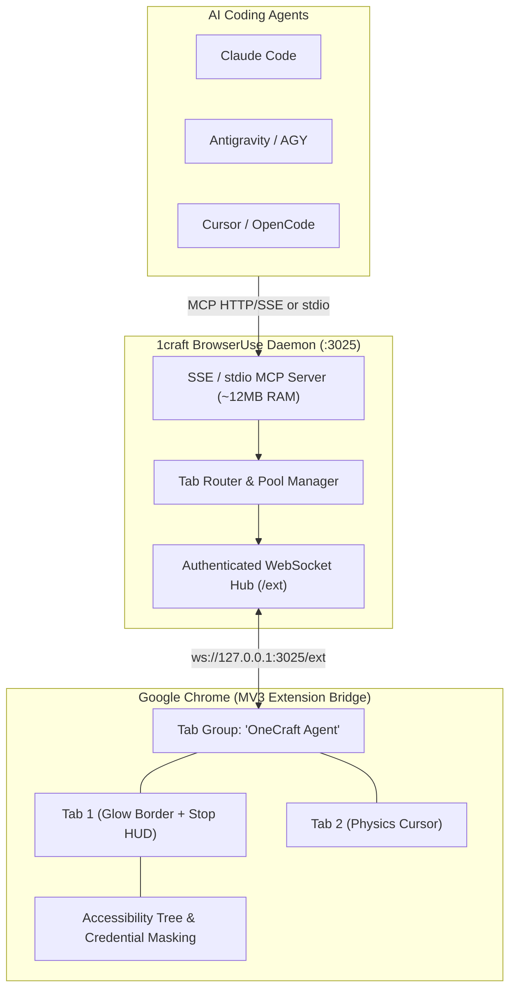

# 1craft BrowserUse (v2.0.0)

> **Control your browser with your AI — Full Claude Code & Claude in Chrome Parity**

[](https://github.com/chavisnguyen/1craft-browseruse/releases)
[](https://github.com/chavisnguyen/homebrew-browseruse)
[](https://github.com/chavisnguyen/1craft-browseruse/actions/workflows/ci.yml)
[](https://golang.org)
[](https://modelcontextprotocol.io)
[](LICENSE)
[](README.md)

**1craft BrowserUse** is an ultra-lightweight (~12MB RAM), blazingly fast [Model Context Protocol (MCP)](https://modelcontextprotocol.io) server written in **Golang**. It connects AI coding agents (**Claude Code**, **Antigravity / AGY**, **Cursor**, **OpenCode**, **Kiro**, **Claude Desktop**) directly to your real browser sessions, cookies, logins, and multiple Chrome profiles—**with 100% feature and tool parity to official Claude Code & Claude in Chrome**.

No heavy Python/Node runtimes, **no macOS Full Disk Access needed**, and **no mouse hijacking**.

---

## ⚡ Highlights

* **100% Claude Code Standard Parity:** Clean 13-tool MCP interface (`read_page`, `computer`, `form_input`, `navigate`, `find`, `read_network_requests`, `read_console_messages`, `file_upload`, `javascript_tool`, `tabs_context_mcp`, `tabs_create_mcp`, `tabs_close_mcp`, `browser_batch`) plus `get_browser_status`.
* **Terracotta Glowing Border:** When an agent reads or interacts with a page, the viewport illuminates with a signature terracotta pulsing glow (`rgba(217, 119, 87, ...)`), making it immediately clear which tab the AI is controlling.
* **Emergency Stop HUD Pill:** A sleek floating capsule HUD at the top-center of the screen displays real-time agent status (`"OneCraft is interacting..."`) and includes an instant **Stop** button to abort execution.
* **Fitts's Law Physics Cursor:** Injects a realistic virtual cursor that glides smoothly across coordinates with natural human-like kinematics: elbow curved arc, velocity-based tilt/lean, overshoot settling, and animated click ripples.
* **Accessibility Tree (AXTree) Perception:** Deterministic `@e1`, `@e2`, ... element references mapped directly from the browser's accessibility tree. Eliminates selector hallucinations and provides sub-millisecond targeting.
* **Automatic Credential Masking:** Sensitive input fields (`password`, `one-time-code`, `cc-number`, `credit-card`, `cvv`) are automatically redacted into `[REDACTED]` in page summaries to prevent secret leakage to LLMs.
* **Chrome Tab Groups ("OneCraft Agent"):** Automatically creates and manages agent tabs inside an organized, color-coded Chrome Tab Group titled **"OneCraft Agent"**, preventing tab clutter.
* **Clean Screenshot Suppression:** Visual indicators (border, stop HUD, virtual cursor) are cleanly hidden for 1 frame during `screenshot` capture, ensuring multimodal vision models receive unpolluted page screenshots.
* **Anti-Hang CDP Dialog Handling:** Intercepts `window.alert`, `window.confirm`, and `window.prompt` via CDP `Page.javascriptDialogOpening` to prevent automation hangs.
* **Ultra-Lightweight Go Daemon (~12MB RAM):** Written in pure Go. Serves multiple AI agents simultaneously while consuming less than 15MB memory.
* **Multi-Profile Isolation:** Seamlessly bridge multiple Chrome profiles (`personal`, `work`, or logged-in Google Accounts) simultaneously with zero cross-profile leakage.

---

## 🏗️ Architecture



### Backend Resolution Hierarchy

When an agent requests an action or new tab, the router selects the best available backend in order:

| Priority | Backend Engine | Activation Condition | macOS Permissions | Profiles & Cookies | User Experience |
| :---: | :--- | :--- | :---: | :--- | :--- |
| **1 (Recommended)** | **OneCraft Extension Bridge** | Extension online in Chrome | 🟢 **None (No FDA)** | ✅ All logged-in profiles & cookies (`work`, `personal`) | Organized "OneCraft Agent" Tab Group; glowing border & stop HUD |
| **2** | **Existing Chrome (CDP)** | `chrome://inspect` enabled; no extension | 🟡 **Full Disk Access** required for terminal | ✅ Primary profile | Direct tabs in active Chrome window |
| **3** | **Dedicated Chrome (Port 9222)** | Started via `make chrome` | 🟢 None | ✅ (Main) / ❌ (Isolated) | Standalone Chrome instance |
| **4** | **Fallback Headless Chrome** | None of the above available | 🟢 None | ❌ Ephemeral session (cookies lost on exit) | Headless background process |

---

## 🚀 Quickstart

### Method 1: Homebrew (Recommended — No Go Runtime Needed)

```bash
brew tap chavisnguyen/browseruse
brew install browseruse

# Start the shared background MCP daemon (managed via macOS launchd)
brew services start browseruse

# Verify health status anytime
1craft-browseruse doctor
```

Get your extension authentication token:
```bash
1craft-browseruse -token
```

Load the extension in Chrome:
1. Open Chrome and navigate to `chrome://extensions`.
2. Turn ON **Developer mode** (top-right toggle).
3. Click **Load unpacked** and select:
   ```
   $(brew --prefix)/share/browseruse/extension
   ```
4. In extension Options, paste your token and click **Save & Connect**.
5. Add `http://localhost:3025/mcp` to your MCP client (Claude Code, AGY, Cursor, OpenCode).

---

### Method 2: From Source (Developers)

#### Prerequisites
* macOS, Linux, or Windows (WSL)
* [Go 1.22+](https://golang.org) installed
* Google Chrome (or Chromium-based browser)

#### 1-Click Setup

Clone the repository and run:

```bash
git clone https://github.com/chavisnguyen/1craft-browseruse.git
cd 1craft-browseruse
make setup
```

This single command will:
1. Compile the high-performance Go binary (`bin/browseruse`).
2. Generate a secure cryptographic authentication token.
3. Automatically embed credentials into `extension/default_config.json`.
4. Register the MCP server across **AGY**, **Claude Code**, **Claude Desktop**, **Cursor**, and **OpenCode**.
5. Start the background SSE daemon on port `3025`.
6. Copy the absolute path of the `extension/` directory straight to your clipboard (macOS).

Then open `chrome://extensions`, enable **Developer mode**, click **Load unpacked**, and select the `extension` folder (`Cmd+Shift+G` -> `Cmd+V` -> `Enter`).

---

## 🛠️ Makefile Commands

| Command | Description |
| :--- | :--- |
| `make setup` | **1-Click zero-config setup**: compiles binary, configures tokens, installs MCP, and launches daemon |
| `make daemon` | Start the MCP SSE server in the background at `http://localhost:3025/mcp` |
| `make stop` | Stop the background SSE daemon |
| `make restart` | Restart the background SSE daemon |
| `make status` | Check status of the daemon and connected browser instances |
| `make doctor` | Run full health diagnostics (auth token, daemon reachability, extension path, CDP) |
| `make token` | Print the current cryptographic authentication token |
| `make install` | Configure MCP in SSE mode (`http://localhost:3025/mcp`) for all installed agents |
| `make install-stdio` | Configure MCP in stdio mode (direct binary execution) |
| `make chrome` | Launch Chrome with remote debugging on port 9222 (optional legacy CDP fallback) |
| `make test` | Run the full automated integration and characterization test suite |
| `make clean` | Remove compiled binaries, temporary logs, and PID files |

---

## 🌐 Available MCP Tools (Claude Code Standard Parity)

AI agents connected to 1craft BrowserUse have access to the **standard 13-tool Claude Code specification**:

| Tool | Parameters | Description |
| :--- | :--- | :--- |
| `read_page` | `filter` *(optional string: 'interactive' or 'all')*<br>`tab_id` *(optional string)* | Reads page URL, title, and interactive element hierarchy mapped with deterministic references (`@e1`, `@e2`, ...) via full **Accessibility Tree (AXTree)**. Automatically masks passwords and sensitive data as `[REDACTED]`. Activates the glowing border & Stop HUD. |
| `computer` | `action` *(required string: left_click, right_click, double_click, triple_click, middle_click, mouse_move, hover, type, key, scroll, drag, screenshot)*<br>`selector` *(optional string: '@e1' or CSS)*<br>`text` *(optional string)*<br>`key` *(optional string: 'Enter', 'Tab', etc.)*<br>`direction` *(optional string: 'down', 'up', 'top', 'bottom')*<br>`amount` *(optional int: pixels, default 500)*<br>`from` *(optional string)*<br>`to` *(optional string)*<br>`screenshot` *(optional bool)*<br>`tab_id` *(optional string)* | Unified interaction tool. Dispatches physical mouse, keyboard, and screen actions with natural **Fitts's Law physics motion**, elbow curved arcs, tilt lean, overshoot, and click ripple. Suppresses HUD overlays during screenshots. |
| `form_input` | `ref_id` *(required string: '@e1' or selector)*<br>`value` *(optional string)*<br>`checked` *(optional bool)*<br>`tab_id` *(optional string)* | Smart form control: sets text input/textarea values, selects dropdown options, or toggles checkboxes/radio buttons by element reference (`@e1`). |
| `navigate` | `url` *(optional string)*<br>`action` *(optional string: 'back', 'forward', 'reload')*<br>`screenshot` *(optional bool)*<br>`tab_id` *(optional string)* | Navigates the tab to a URL or executes browser history navigation (`back`, `forward`, `reload`). |
| `find` | `query` *(required string)*<br>`tab_id` *(optional string)* | Semantic natural language search to locate elements on the page (e.g. `'Sign In button'`, `'search bar'`, `'pricing plans'`). |
| `read_network_requests` | `clear` *(optional bool)*<br>`filter` *(optional string)*<br>`tab_id` *(optional string)* | Inspects captured HTTP/Fetch/XHR network requests and API responses (URL, method, status, mimeType) for web debugging. |
| `read_console_messages` | `clear` *(optional bool)*<br>`tab_id` *(optional string)* | Retrieves captured JavaScript console logs, errors, and warnings for runtime debugging. |
| `file_upload` | `selector` *(required string)*<br>`files` *(required string)*<br>`tab_id` *(optional string)* | Uploads local files to an `<input type='file'>` form element (`@e1` or CSS selector). |
| `javascript_tool` | `script` *(required string)*<br>`tab_id` *(optional string)* | Evaluates arbitrary JavaScript code in the context of the page and returns the serialized result. |
| `tabs_context_mcp` | *none* | Returns the current browser context: managed tabs, URLs, titles, active tab marker, and Chrome Tab Group status. |
| `tabs_create_mcp` | `url` *(optional string)*<br>`profile` *(optional string)* | Opens a new independent browser tab inside the managed **OneCraft Agent** Chrome Tab Group. |
| `tabs_close_mcp` | `tab_id` *(optional string)* | Closes a specific tab when the agent finishes its task (defaults to active tab). |
| `browser_batch` | `actions` *(required JSON array of action objects)*<br>`tab_id` *(optional string)* | Executes a batch of sequential computer/navigate actions in a single roundtrip to eliminate IPC latency. |
| `get_browser_status` | *none* | Returns comprehensive system diagnostics, connected extension profiles, and open tab allocations. |

---

## 🎨 Visual Identity & Safety Layer

* **Terracotta Glowing Border (`#claude-agent-glow-border`):** Whenever an agent is actively reading or controlling a page, the entire viewport illuminates with a pulsating terracotta glow (`rgba(217, 119, 87, ...)`).
* **Emergency Stop HUD (`#claude-agent-stop-container`):** A sleek frosted-glass floating capsule pinned at the top-center of the viewport shows the current agent action (`"OneCraft is interacting..."`) and includes an instant **Stop** button to abort agent operations immediately.
* **Fitts's Law Physics Cursor (`ClaudeCursorMotion`):** The virtual pointer moves with human-like kinematics: curved elbow arcs, velocity-based tilt lean, micro-overshoot settling, and animated click ripples.
* **Clean Screenshot Suppression:** All visual indicators (border, stop HUD, cursor, badges) are cleanly hidden during screenshot capture (`hidden_for_screenshot`), giving vision models an unpolluted image of the page.
* **Security & Credential Masking:** Sensitive input fields (`password`, `one-time-code`, `cc-number`, `credit-card`, `cvv`) are masked as `[REDACTED]` in accessibility tree snapshots to protect user credentials.
* **OneCraft Agent Tab Group:** Tabs opened by the AI are automatically organized in an orange Chrome Tab Group titled **"OneCraft Agent"**, keeping your workspace clean and separated from personal browsing.

---

## 🎯 Example Agent Interaction Flow

Here is how an AI agent browses using the v2.0.0 toolset:

```text
1. Agent creates a tab in the OneCraft Agent group:
   tabs_create_mcp(url="https://news.ycombinator.com")

   Response:
   ✅ Created new tab `tab-1` in OneCraft Agent tab group.
   **Tab ID**: `tab-1`
   **Current URL**: `https://news.ycombinator.com/`
   **Page Title**: Hacker News
   **Accessibility Tree Elements**:
   @e1 [link] ""
   @e2 [link] "Hacker News"
   @e3 [link] "new"
   @e4 [link] "past"
   @e227 [textbox] "" [name="q" type="text"]

2. Agent hovers or clicks an element using the physics cursor:
   computer(action="hover", selector="@e2")
   computer(action="left_click", selector="@e3", screenshot=true)

   Response:
   ✅ Executed `left_click` on `tab-1`.
   Result: {"action":"left_click","button":"left","clicked":true,"coordinate":[275,20]}
   📸 **Screenshot**: `/tmp/screenshot-1793779251725715000.png`

3. Agent fills a form input by reference (@e227):
   form_input(ref_id="@e227", value="Claude Browser Use")
   computer(action="key", key="Enter")

4. Agent inspects network requests or console logs for debugging:
   read_console_messages(clear=true)
   read_network_requests(filter="ycombinator")
```

---

## 👥 Multi-Profile Usage & Agent Prompting

You can run the extension across multiple Google Chrome profiles simultaneously (e.g. personal profile, company work profile, or staging accounts).

### Automatic Profile Labeling

When the extension is loaded into a profile signed in with a Google Account, 1craft BrowserUse automatically derives a human-friendly profile label:
* `user@gmail.com` ➔ `gmail_user`
* `alice@company.com` ➔ `company_alice`

You can also customize the label at any time in **Extension Options**.

### Prompting Examples

* **Single Profile Connected:**
  Agents automatically route tabs to the single online profile without requiring explicit parameters.
* **Multiple Profiles Connected:**
  Agents can specify the target profile when creating tabs:
  ```text
  "Open my company dashboard in the work profile and download the weekly sales report."
  ```
  The agent will invoke:
  ```json
  tabs_create_mcp({"url": "https://dashboard.internal", "profile": "work"})
  ```
* If multiple profiles are connected and no profile is specified, the server responds with a descriptive list of all available profile labels so the agent can self-correct.

---

## ⚙️ Configuration & Environment Variables

Configuration can be specified via environment variables or a local `.env` file:

| Variable | Default | Description |
| :--- | :--- | :--- |
| `PORT` | `3025` | Port for the HTTP/SSE MCP daemon and WebSocket hub. |
| `HOST` | *(empty)* | Specific host to bind (default empty: binds dual-stack loopback `127.0.0.1` and `[::1]`). |
| `CHROME_CDP_URL` | `http://127.0.0.1:9222` | Fallback CDP endpoint (used when Extension Bridge is not connected). |
| `BROWSER_HEADLESS` | `true` | Headless mode for fallback standalone Chrome. Set to `false` to show GUI. |

---

## 🧯 Troubleshooting

### Extension shows "Disconnected" or red badge
* Ensure the daemon is running (`make daemon` or `1craft-browseruse doctor`).
* Verify the auth token: run `make token`, open **Extension Options**, paste the token, and click **Save & Connect**.

### Chrome displays yellow banner: *"1craft BrowserUse started debugging this browser"*
* This is a standard Google Chrome security alert when an extension connects to a tab via `chrome.debugger`. It is completely normal, expected, and safe.

### Agent reports *"multiple extension profiles online"*
* Two or more Chrome profiles are connected. Instruct your agent to specify which profile to use (e.g., `profile="work"` or `profile="gmail_dungg"`), or check online profiles with `get_browser_status`.

### Agent reports *"label_in_use"*
* Two Chrome windows/profiles are configured with the identical profile label. Open **Extension Options** in one of them and give it a unique name.

### macOS `operation not permitted` when reading `DevToolsActivePort`
* This only occurs when using the legacy CDP fallback without the extension. The recommended solution is to load the **1craft Chrome Extension**, which requires **no Full Disk Access**. If you must use legacy CDP, grant Full Disk Access to your terminal app in *System Settings → Privacy & Security → Full Disk Access*.

---

## 🔒 Security & Privacy

* **Strict Loopback Binding:** The daemon and WebSocket hub bind exclusively to `127.0.0.1` and `[::1]`. No external network exposure.
* **Cryptographic Authentication:** WebSocket connections from the Chrome extension require a cryptographically generated token stored locally with restricted permissions (`0600`).
* **Origin Verification:** All incoming WebSocket connections validate the `Origin` header against valid Chrome Extension IDs (`chrome-extension://*`).
* **Credential Redaction:** Passwords, OTPs, and credit card numbers are masked at the browser extension layer before sending DOM trees to the MCP server or agent context.
* **Zero Telemetry / 100% Local:** No logs, browsing activity, cookies, or prompt data are transmitted to any external servers. Everything executes entirely on your machine.

---

## 📄 License

This project is licensed under the [MIT License](LICENSE).
